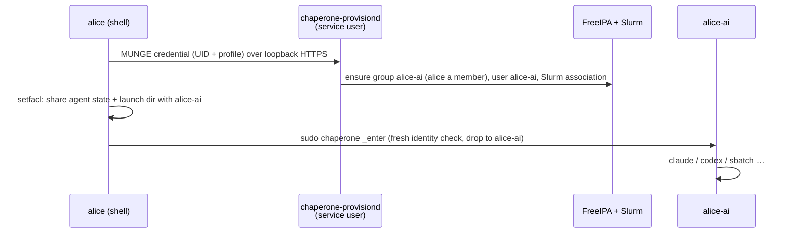

<div align="center">

# Chaperone

**Your AI agents, your environment, their own identity.**

Run Claude Code, Codex, OpenCode, scripts and Slurm jobs on an HPC cluster
under a separate, automatically created Unix identity, with your logins,
settings and memories intact.

[](https://github.com/HudoGriz/hpc-chaperone/actions/workflows/ci.yml)
[](https://github.com/HudoGriz/hpc-chaperone/actions/workflows/integration.yml)

</div>

---

```sh
cd ~/projects/analysis
chaperone claude                         # Claude Code as alice-ai
chaperone codex exec "summarise results" # Codex as alice-ai
chaperone sbatch pipeline.sh             # the job runs as alice-ai
chaperone -p ai-special -- nextflow run  # another profile, another identity
chaperone                                # a shell as the persona
```

## Why

An agent running as you can read everything you can, including restricted
data your groups open up. Chaperone runs it as **`<you>-ai`**, a real
directory user that holds none of your groups:

| The persona | |
| --- | --- |
| **can** use your agent logins, settings, skills and memories | `~/.claude`, `~/.codex`, … shared read-write |
| **can** run your per-user agent installs | `~/.local/share/claude`, … read-only |
| **can** work in the directory you launched it from | read-write both ways |
| **can** submit Slurm jobs | under its own account, on every node |
| **cannot** read the rest of your HOME, your keys, or your groups' data | |
| **cannot** use sudo, launch personas, or log in | |

**You keep full control** of everything the persona creates. You are a member
of its group, and shared directories carry default ACLs for both of you.

> [!NOTE]
> Chaperone does not hide data that is world-readable: the persona sees what
> any user on the cluster sees. Fix permissions at the source.

## How it works



- **One Go binary, no dependencies.** It is the client, the root-only
  `_enter` identity switch, the `provisiond` broker and `_uninstall`.
- **The broker is never root.** A FreeIPA role lets it create users and
  groups and change members of persona groups only. In Slurm it coordinates
  the persona accounts only.
- **Fail closed.** If any check fails, nothing runs, and nothing ever runs as
  you instead.
- **Compute nodes need nothing.** Personas are ordinary SSSD and Slurm users.

## Install

You need FreeIPA (SSSD on all nodes), Slurm with accounting, MUNGE, sudo,
POSIX ACLs and EL9 login nodes. Take the `el9` artifact from CI: the binary
and `deploy/`, sha256-checked. The inventory needs three groups:

```ini
[chaperone]            # login nodes: client + broker
login1.example.org
[chaperone_ipa]        # one FreeIPA server
ipa1.example.org
[chaperone_slurmdbd]   # the slurmdbd host
slurm.example.org
```

```sh
cp deploy/vars.example.yml site.yml        # eligible users, policy
ansible-playbook -i inventory -e @site.yml deploy/install.yml
```

The playbook sets up:

- **FreeIPA**: the broker's role and the eligibility group with its members
  ([`deploy/ipa.py`](deploy/ipa.py), run as root over LDAPI, no admin
  password).
- **Slurm**: a persona account per profile, with the broker as coordinator
  ([`deploy/slurm.sh`](deploy/slurm.sh)).
- **Login nodes**: the binary, the policy, and the keytab (fetched with the
  host principal, so it never travels). Then the loopback broker, and last
  [the sudo rule](deploy/chaperone.sudoers).

Re-running the playbook is safe. To add a user, append them to
`chaperone_users` and re-run. [docs/operations.md](docs/operations.md)
covers the pilot order, the blast radius and the kill switch.

## Uninstall

```sh
ansible-playbook -i inventory -e @site.yml deploy/uninstall.yml
```

Everything goes, in this order:

1. the sudo rule;
2. persona jobs and Slurm accounts;
3. persona processes, files and ACL entries in users' directories
   (`chaperone _uninstall`; files go back to their humans);
4. personas, persona groups and the role in FreeIPA;
5. the binary, configuration, keytab and service user.

CI runs the FreeIPA and Slurm uninstall against disposable services, and the
host uninstall with real UIDs and ACLs, and checks that nothing is left.

## Policy

`/etc/chaperone/policy.json` is root-owned, strict JSON:

```json
{
  "default_persona": "ai",
  "provision_url": "https://localhost:9443",
  "eligible_groups": ["chaperone-users"],
  "shared_paths": [".claude", ".codex", ".config/opencode"],
  "exec_paths": [".local/bin", ".local/share/claude"],
  "personas": {"ai": {"slurm_account": "agents"}}
}
```

A new profile is one more `personas` entry. Slurm limits, QOS and partitions
belong to its account. Credential directories (`.ssh`, `.gnupg`, `.netrc`,
`.aws`, `.config/gh`) can never be shared.

## Trust model

- **Agent state is shared.** A persona can edit hooks or MCP settings that
  you later run unchaperoned. Treat `~/.claude` and its siblings as your
  trust boundary.
- **Some files need a launch to repair.** A file a tool writes `0600` is
  repaired on the next launch or exit. In a launch directory it stays
  masked until `chaperone -- chmod`.
- **Unchaperoned agents are allowed.** Chaperone protects people who use it.
  It does not police those who don't.

## Development

```sh
make test lint build   # unit tests (race), vet, el9-compatible build
make secrets           # gitleaks over the whole history
```

| Path | What |
| --- | --- |
| `main.go` | client: options, provisioning request, sharing, sudo |
| `broker.go` | `provisiond`: MUNGE check, FreeIPA and Slurm reconcile |
| `enter.go` | `_enter`: fresh identity checks, privilege drop, launch log |
| `acl.go` | sharing with the persona: descriptor-pinned ACL walks |
| `uninstall.go` | `_uninstall`: undo launches on a host |
| `policy.go` | site policy |
| `deploy/` | Ansible install/uninstall, FreeIPA and Slurm helpers, sudo rule |
| `tests/e2e` | real UIDs, sudo, ACLs, MUNGE (CI) |
| `tests/integration` | disposable FreeIPA and Slurm, broker with its real rights (CI) |

Contributors and coding agents follow the [postulates](AGENTS.md).

MIT licensed.
