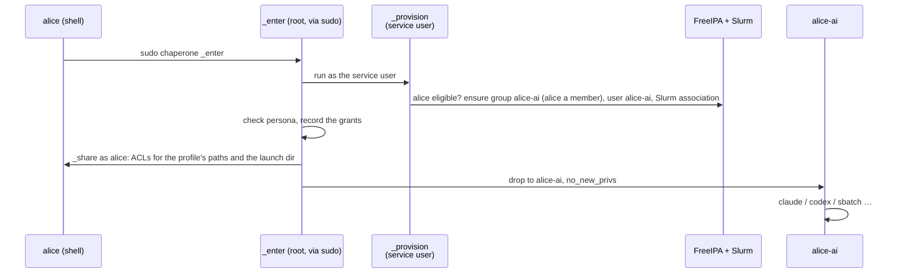

<div align="center">

# Chaperone

**Your AI agents, your environment, their own identity.**

Run Claude Code, Codex, OpenCode, scripts and Slurm jobs on an HPC cluster
under a separate, automatically created Unix identity, with your logins,
settings and memories intact.

[](https://github.com/HudoGriz/hpc-chaperone/actions/workflows/ci.yml)
[](https://github.com/HudoGriz/hpc-chaperone/actions/workflows/integration.yml)

</div>

---

```sh
cd ~/projects/analysis
chaperone claude                            # Claude Code as alice-ai
chaperone codex exec "summarise results"    # Codex as alice-ai
chaperone sbatch pipeline.sh                # the job runs as alice-ai
chaperone -p ai-restrictive -- claude       # another profile, another identity
chaperone                                   # a shell as the persona
```

## Why

An agent running as you can read everything you can, including restricted
data your groups open up. Chaperone runs it as **`<you>-<profile>`**, a real
directory user that holds none of your groups. What else it reaches is the
site's choice, per profile:

| The persona | `ai` (example default) | `ai-restrictive` |
| --- | --- | --- |
| uses your agent logins, settings, skills and memories (`~/.claude`, …) | read-write | read-write |
| runs your per-user agent installs (`~/.local/share/claude`, …) | read-only | read-only |
| working directory sharing | auto (if eligible) | off |
| lists your HOME and reads what any user may | yes | no |
| reads chosen dotfiles (`.bash_profile`, `.gitconfig`, …) | read-only | no |
| starts through your login shell (modules, conda, PATH) | yes | no |
| submits Slurm jobs, under its own account, on every node | yes | yes |
| reads your groups' data or writes HOME itself | **never** | **never** |
| accesses sensitive paths | only if explicitly granted by site policy | only if explicitly granted by site policy |
| uses sudo or gains setuid privileges in the locally launched process | **never** | **never** |

**You keep control** of what the persona creates: you are a member of its
group, and shared directories carry default ACLs for both of you.

> [!NOTE]
> Chaperone does not hide data that is world-readable: the persona sees what
> any user on the cluster sees. Fix permissions at the source.

## How it works



- **One Go binary, no daemon.** It is the client, the root-only `_enter`
  identity switch, the `_provision` broker, the `_share` step and
  `_uninstall`.
- **The broker is never root.** `_enter` runs it as the service user with a
  keytab only that user reads. A FreeIPA role lets it create users and
  groups and change members of persona groups only; in Slurm it coordinates
  the persona accounts only. It checks eligibility in FreeIPA on every
  launch, so a revoked user is refused at once.
- **Sharing runs as you.** ACLs are set by a child running as you, so it can
  change only what you could change yourself. Root records every grant
  first; uninstall and policy changes work from that record.
- **Fail closed.** If any check fails, nothing runs, and nothing ever runs as
  you instead.
- **Compute nodes need nothing.** Personas are ordinary SSSD and Slurm users.

## Install

You need FreeIPA (SSSD on all nodes), Slurm with accounting
(`AccountingStorageEnforce=associations`), MUNGE, sudo, POSIX ACLs and EL9
login nodes. Take the `el9` artifact from CI: the binary and `deploy/`,
sha256-checked. It is built only when every other check of the same commit
passed. The inventory needs three groups:

```ini
[chaperone]            # login nodes
login1.example.org
[chaperone_ipa]        # one FreeIPA server
ipa1.example.org
[chaperone_slurmdbd]   # the slurmdbd host
slurm.example.org
```

```sh
cp deploy/vars.example.yml site.yml        # eligible users, profiles
ansible-playbook -i inventory -e @site.yml deploy/install.yml
```

The playbook stops on any failure on any host, and in this order sets up:

- **Login nodes**: required tools are checked, then the binary and the
  policy, which must parse before anything else changes.
- **FreeIPA**: the broker's role and the eligibility group; membership stays
  under the control of FreeIPA administrators
  ([`deploy/ipa.py`](deploy/ipa.py), run as root over LDAPI, no admin
  password).
- **Slurm**: a persona account per profile, with the broker as coordinator
  ([`deploy/slurm.sh`](deploy/slurm.sh)).
- **Login nodes**: the keytab, fetched with the host principal so it never
  travels (and fetched again if it stops working), and last
  [the sudo rule](deploy/chaperone.sudoers).

Re-running is safe. To add or remove an eligible human, update the designated
FreeIPA group through normal site administration; Chaperone never synchronizes
membership. Existing non-Chaperone Slurm accounts are refused. Existing
FreeIPA eligibility groups are read without modification. [docs/operations.md](docs/operations.md) covers the
pilot order, the blast radius and the kill switch.

## Uninstall

```sh
ansible-playbook -i inventory -e @site.yml deploy/uninstall.yml                          # retire
ansible-playbook -i inventory -e @site.yml -e chaperone_purge=true deploy/uninstall.yml  # purge
```

Both stop this deployment, in this order, and any failure stops the run:

1. the sudo rule;
2. persona jobs (the run fails if any survive) and Slurm accounts;
3. persona processes (`chaperone _uninstall`);
4. the broker's role, service and the eligibility group in FreeIPA;
5. the binary, configuration, keytab and service user.

**Retire** (default) keeps each recorded persona, disabled, and its group. What it
created, anywhere, stays owned by a named identity you share a group with:
nothing is orphaned and no file tree is walked. Its ACL entries stay, inert.
Reinstalling does **not** automatically re-enable a disabled persona. A FreeIPA administrator must explicitly reactivate retired identities.

**Purge** also hands persona files in the recorded trees back to their
humans, removes every recorded ACL entry (`chaperone _uninstall --purge`)
and deletes the personas and their groups. Persona files outside the
recorded trees (scratch, `/tmp`) then keep a bare UID; see
[docs/operations.md](docs/operations.md). To purge after a retire, install
again first.

## Policy

`/etc/chaperone/policy.json` is root-owned, strict JSON. Each profile is its
own identity `<user>-<profile>`:

```json
{
  "default_persona": "ai",
  "eligible_groups": ["chaperone-users"],
  "personas": {
    "ai": {
      "slurm_account": "agents",
      "list_home": true,
      "workdir": "auto",
      "login": true,
      "shell": "/bin/bash",
      "forward_env": ["TERM", "LANG", "https_proxy", "ANTHROPIC_API_KEY", "OPENAI_API_KEY"],
      "env": {"CLAUDE_CONFIG_DIR": "${HOME}/.claude"},
      "seed_files": [{"from": ".claude.json", "to": ".claude/.claude.json"}],
      "write": [".claude", ".codex", ".config/opencode"],
      "read": [".local/bin", ".local/share/claude", ".bash_profile", ".bashrc", ".profile", ".gitconfig"]
    },
    "ai-restrictive": {
      "slurm_account": "agents",
      "workdir": "off",
      "write": [".claude", ".codex", ".config/opencode"],
      "read": [".local/bin", ".local/share/claude"]
    }
  }
}
```

| Key | Effect |
| --- | --- |
| `write` | HOME-relative directories or files, read-write; a missing directory is created |
| `read` | HOME-relative directories or files, read-only; missing ones are skipped |
| `list_home` | HOME is listable (`r-x`), so the persona reads what any user may; otherwise traverse-only |
| `workdir` | `off` (default): do not share current directory; `auto`: share when eligible, otherwise continue with a note; `required`: refuse launch if it cannot be shared |
| `login` | launch through a POSIX-compatible login shell, reading startup files listed under `read` |
| `shell` | absolute POSIX-compatible shell for interactive sessions and `login`; defaults to `/bin/bash` for existing profiles |
| `forward_env` | exact variable names retained by sudo and passed to this persona; no built-in harness or credential patterns |
| `env` | profile-defined variable values; only `${HOME}` is expanded to the human's HOME (no shell evaluation) |
| `seed_files` | optional one-time HOME-relative `from`→`to` copies, without overwriting existing files; destination must be inside a `write` path |
| `slurm_account` | the persona's Slurm account: its limits, QOS and partitions |
| `slurm_limits` | limits install sets on that account, e.g. `{"MaxJobs": "50", "GrpTRES": "cpu=64"}`; none by default, `-1` clears one; profiles sharing an account must agree |

Paths are canonical (`.claude`, not `./.claude/`), never HOME itself, and
never overlap each other, in either direction. HOME itself is never writable.
**All dotfile access is chosen by the root-owned profile.** Nothing is hardcoded
as an allowed or denied credential path; administrators must carefully assess
sensitive paths such as `.ssh`, `.aws`, or agent tokens before explicitly granting
access. A path removed from a profile is revoked at the next launch.

## Trust model

- **Agent state is shared.** A persona can edit hooks, MCP settings or
  memories that you later run unchaperoned. Treat `~/.claude` and its
  siblings as your trust boundary.
- **Working-directory sharing is profile-controlled.** With `workdir: auto|required`, a human-owned project directory may be shared and modified, including `.git/config` and hooks. With `workdir: off`, it is not shared.
- **Your control is cooperative.** The persona owns what it creates and
  could lock you out of it (`chmod 600`); uninstall hands everything in the
  recorded trees back to you.
- **Some files need a launch to repair.** A file a tool writes `0600` is
  repaired on the next launch or exit. In a launch directory it stays
  masked until `chaperone -- chmod`.
- **Unchaperoned agents are allowed.** Chaperone protects people who use it.
  It does not police those who don't.

## Repository layout

```text
cmd/chaperone/        the one binary, package main
  main.go             client: options, then exec sudo
  enter.go            _enter: provision, check, record, share, privilege drop; _share
  broker.go           _provision: FreeIPA and Slurm reconcile as the service user
  acl.go              sharing with the persona: descriptor-pinned, mask-preserving ACLs
  uninstall.go        the grant record, revocation and _uninstall
  policy.go           /etc/chaperone/policy.json
  *_test.go           unit tests next to the code they test
deploy/               everything a site runs
  install.yml         Ansible: login nodes, FreeIPA, Slurm
  uninstall.yml       Ansible: retire (default) or purge
  vars.example.yml    site variables
  ipa.py, slurm.sh    FreeIPA and Slurm objects (used by the playbooks and CI)
  chaperone.sudoers   the sudo rule
  policy.example.json policy reference
docs/operations.md    pilot order, blast radius, broker privileges, kill switch
tests/e2e/            install.yml and uninstall.yml, real UIDs, sudo, ACLs (CI)
tests/integration/    disposable FreeIPA and Slurm, broker with its real rights (CI)
AGENTS.md             postulates every contributor and agent follows
```

## Development

```sh
make test lint build   # unit tests (race), vet, binary ./chaperone
make secrets           # gitleaks over the whole history
```

CI also runs e2e (the real playbooks, real UIDs, sudo, ACLs) and integration
(disposable FreeIPA and Slurm), and builds the `el9` artifact. Contributors and coding
agents follow the [postulates](AGENTS.md); tests encode them.

MIT licensed.

### Teardown scope

The FreeIPA teardown receives the exact persona names printed by login nodes from their root-owned grant records. It no longer enumerates/deletes all `chaperone:*` identities across an entire FreeIPA realm. Personas provisioned but never successfully recorded may remain and require an administrator to inspect and retire manually. Reinstallation never re-enables disabled personas without explicit administrator approval.

### Multiple broker hosts

FreeIPA role, privilege and permission objects are named per broker host, and uninstall leaves the potentially shared eligibility group in place. Older unscoped `Chaperone broker` FreeIPA objects from pre-refactor installations must be reviewed and removed by a FreeIPA administrator during migration; this PR deliberately does not delete unknown shared legacy roles.

### Slurm worker privilege boundary

`no_new_privs` is set on the local Chaperone-launched process and its direct descendants. A batch job is started separately by Slurm daemons, so do **not** assume this attribute propagates to `sbatch` jobs. Verify worker-side UID, groups, PAM/sudoers, and privilege restrictions in the site pilot.

When a persona profile changes `workdir` to `off`, the next launch revokes previously recorded working-directory grants for that persona; large old trees can require substantial one-time metadata work. Existing workdir grants otherwise remain recorded for cleanup across launches.

### Harness-neutral configuration

Chaperone has no built-in Claude/Codex/OpenCode directory exceptions, configuration
copies, or token forwarding patterns. A site's root-owned profile explicitly
declares `read`/`write`, `forward_env`, fixed `env`, and optional
`seed_files`. Example: the `ai` profile copies `.claude.json` into its
shared `.claude` directory once and chooses `CLAUDE_CONFIG_DIR`; without
those fields there is no implicit special handling. Sudo receives the union
of exact `forward_env` names in installed profiles and the launcher passes
only those selected by the *current* persona. Reinstall when changing the
forwarded set to update the root-owned sudo rule. Do not grant credentials
or agent environment variables to profiles that should not receive them.
