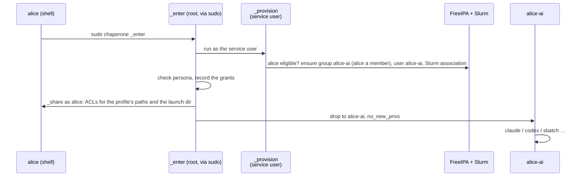

<div align="center">

# Chaperone

**Your AI agents, your environment, their own identity.**

Run Claude Code, Codex, OpenCode, scripts and Slurm jobs on an HPC cluster
under a separate, automatically created Unix identity, with your logins,
settings and memories intact.

[](https://github.com/HudoGriz/hpc-chaperone/actions/workflows/ci.yml)
[](https://github.com/HudoGriz/hpc-chaperone/actions/workflows/integration.yml)

</div>

---

```sh
cd ~/projects/analysis
chaperone claude                            # Claude Code as alice-ai
chaperone codex exec "summarise results"    # Codex as alice-ai
chaperone sbatch pipeline.sh                # the job runs as alice-ai
chaperone -p ai-restrictive -- claude       # another profile, another identity
chaperone                                   # a shell as the persona
```

## Why

An agent running as you can read everything you can, including restricted
data your groups open up. Chaperone runs it as **`<you>-<profile>`**, a real
directory user that holds none of your groups. What else it reaches is the
site's choice, per profile:

| The persona | `ai` (example default) | `ai-restrictive` |
| --- | --- | --- |
| uses your agent logins, settings, skills and memories (`~/.claude`, …) | read-write | read-write |
| runs your per-user agent installs (`~/.local/share/claude`, …) | read-only | read-only |
| works in the directory you launched it from | read-write | read-write |
| lists your HOME and reads what any user may | yes | no |
| reads chosen dotfiles (`.bash_profile`, `.gitconfig`, …) | read-only | no |
| starts through your login shell (modules, conda, PATH) | yes | no |
| submits Slurm jobs, under its own account, on every node | yes | yes |
| reads your groups' data, keys, private (`0600`) files, or writes HOME | **never** | **never** |
| uses sudo or any setuid program, or logs in | **never** | **never** |

**You keep control** of what the persona creates: you are a member of its
group, and shared directories carry default ACLs for both of you.

> [!NOTE]
> Chaperone does not hide data that is world-readable: the persona sees what
> any user on the cluster sees. Fix permissions at the source.

## How it works



- **One Go binary, no daemon.** It is the client, the root-only `_enter`
  identity switch, the `_provision` broker, the `_share` step and
  `_uninstall`.
- **The broker is never root.** `_enter` runs it as the service user with a
  keytab only that user reads. A FreeIPA role lets it create users and
  groups and change members of persona groups only; in Slurm it coordinates
  the persona accounts only. It checks eligibility in FreeIPA on every
  launch, so a revoked user is refused at once.
- **Sharing runs as you.** ACLs are set by a child running as you, so it can
  change only what you could change yourself. Root records every grant
  first; uninstall and policy changes work from that record.
- **Fail closed.** If any check fails, nothing runs, and nothing ever runs as
  you instead.
- **Compute nodes need nothing.** Personas are ordinary SSSD and Slurm users.

## Install

You need FreeIPA (SSSD on all nodes), Slurm with accounting
(`AccountingStorageEnforce=associations`), MUNGE, sudo, POSIX ACLs and EL9
login nodes. Take the `el9` artifact from CI: the binary and `deploy/`,
sha256-checked. It is built only when every other check of the same commit
passed. The inventory needs three groups:

```ini
[chaperone]            # login nodes
login1.example.org
[chaperone_ipa]        # one FreeIPA server
ipa1.example.org
[chaperone_slurmdbd]   # the slurmdbd host
slurm.example.org
```

```sh
cp deploy/vars.example.yml site.yml        # eligible users, profiles
ansible-playbook -i inventory -e @site.yml deploy/install.yml
```

The playbook stops on any failure on any host, and in this order sets up:

- **Login nodes**: required tools are checked, then the binary and the
  policy, which must parse before anything else changes.
- **FreeIPA**: the broker's role and the eligibility group; with
  `chaperone_users` set, exactly those members
  ([`deploy/ipa.py`](deploy/ipa.py), run as root over LDAPI, no admin
  password).
- **Slurm**: a persona account per profile, with the broker as coordinator
  ([`deploy/slurm.sh`](deploy/slurm.sh)).
- **Login nodes**: the keytab, fetched with the host principal so it never
  travels (and fetched again if it stops working), and last
  [the sudo rule](deploy/chaperone.sudoers).

Re-running is safe. To add or remove a user, edit `chaperone_users` and
re-run. Existing groups or Slurm accounts that Chaperone did not create are
refused, never adopted. [docs/operations.md](docs/operations.md) covers the
pilot order, the blast radius and the kill switch.

## Uninstall

```sh
ansible-playbook -i inventory -e @site.yml deploy/uninstall.yml
```

Everything goes, in this order, and any failure stops the run:

1. the sudo rule;
2. persona jobs (the run fails if any survive) and Slurm accounts;
3. persona processes, then everything in the grant record: persona files go
   back to their humans and ACL entries are removed (`chaperone _uninstall`);
4. personas, persona groups and the role in FreeIPA;
5. the binary, configuration, keytab, grant record and service user.

Files a persona left outside the recorded trees (scratch, `/tmp`) keep its
UID; see [docs/operations.md](docs/operations.md).

## Policy

`/etc/chaperone/policy.json` is root-owned, strict JSON. Each profile is its
own identity `<user>-<profile>`:

```json
{
  "default_persona": "ai",
  "eligible_groups": ["chaperone-users"],
  "personas": {
    "ai": {
      "slurm_account": "agents",
      "list_home": true,
      "login": true,
      "write": [".claude", ".codex", ".config/opencode"],
      "read": [".local/bin", ".local/share/claude", ".bash_profile", ".bashrc", ".profile", ".gitconfig"]
    },
    "ai-restrictive": {
      "slurm_account": "agents",
      "write": [".claude", ".codex", ".config/opencode"],
      "read": [".local/bin", ".local/share/claude"]
    }
  }
}
```

| Key | Effect |
| --- | --- |
| `write` | HOME-relative directories or files, read-write; a missing directory is created |
| `read` | HOME-relative directories or files, read-only; missing ones are skipped |
| `list_home` | HOME is listable (`r-x`), so the persona reads what any user may; otherwise traverse-only |
| `login` | the command runs through `bash -l`, with your startup files (list them in `read`) |
| `slurm_account` | the persona's Slurm account: its limits, QOS and partitions |

Paths are canonical (`.claude`, not `./.claude/`), never HOME itself, and
never overlap each other or credential paths (`.ssh`, `.gnupg`, `.netrc`,
`.aws`, `.config/gh`), in either direction. HOME is never writable. A path
removed from a profile is revoked at that persona's next launch.

## Trust model

- **Agent state is shared.** A persona can edit hooks, MCP settings or
  memories that you later run unchaperoned. Treat `~/.claude` and its
  siblings as your trust boundary.
- **The launch directory is shared.** The persona can change anything in
  it, including `.git/config` and hooks your own git runs. For untrusted
  work, let the agent work in its own checkout and review before merging.
- **Your control is cooperative.** The persona owns what it creates and
  could lock you out of it (`chmod 600`); uninstall hands everything in the
  recorded trees back to you.
- **Some files need a launch to repair.** A file a tool writes `0600` is
  repaired on the next launch or exit. In a launch directory it stays
  masked until `chaperone -- chmod`.
- **Unchaperoned agents are allowed.** Chaperone protects people who use it.
  It does not police those who don't.

## Repository layout

```text
cmd/chaperone/        the one binary, package main
  main.go             client: options, then exec sudo
  enter.go            _enter: provision, check, record, share, privilege drop; _share
  broker.go           _provision: FreeIPA and Slurm reconcile as the service user
  acl.go              sharing with the persona: descriptor-pinned, mask-preserving ACLs
  uninstall.go        the grant record, revocation and _uninstall
  policy.go           /etc/chaperone/policy.json
  *_test.go           unit tests next to the code they test
deploy/               everything a site runs
  install.yml         Ansible: login nodes, FreeIPA, Slurm
  uninstall.yml       Ansible: removes all of it
  vars.example.yml    site variables
  ipa.py, slurm.sh    FreeIPA and Slurm objects (used by the playbooks and CI)
  chaperone.sudoers   the sudo rule
  policy.example.json policy reference
docs/operations.md    pilot order, blast radius, broker privileges, kill switch
tests/e2e/            install.yml and uninstall.yml, real UIDs, sudo, ACLs (CI)
tests/integration/    disposable FreeIPA and Slurm, broker with its real rights (CI)
AGENTS.md             postulates every contributor and agent follows
```

## Development

```sh
make test lint build   # unit tests (race), vet, binary ./chaperone
make secrets           # gitleaks over the whole history
```

CI also runs e2e (the real playbooks, real UIDs, sudo, ACLs) and integration
(disposable FreeIPA and Slurm), and builds the `el9` artifact. Contributors and coding
agents follow the [postulates](AGENTS.md); tests encode them.

MIT licensed.
