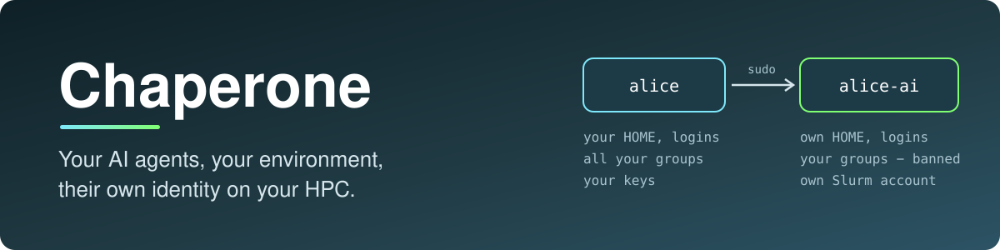
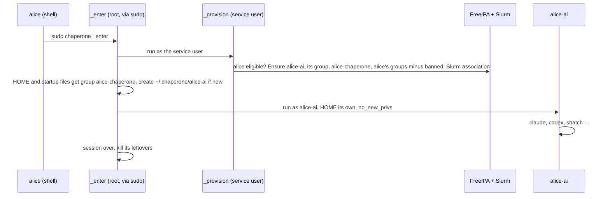

<p align="center">
  
</p>

<p align="center">
  <a href="https://github.com/HudoGriz/hpc-chaperone/actions/workflows/ci.yml"></a>
  <a href="https://github.com/HudoGriz/hpc-chaperone/actions/workflows/integration.yml"></a>
  <a href="#trust-model-and-limits"></a>
  <a href="LICENSE"></a>
  <a href="https://doi.org/10.5281/zenodo.23687633"></a>
</p>

<p align="center">
  <strong>Launch the agent. It runs as its own user. Share only what it needs. Keep your logins, keys and restricted data yours.</strong>
</p>

<p align="center">
  <a href="#quick-start">Quick start</a> ·
  <a href="#copy-tool-state-seed">Seed</a> ·
  <a href="#work-in-a-project-together">Projects</a> ·
  <a href="#how-it-works">How it works</a> ·
  <a href="#trust-model-and-limits">Trust model</a> ·
  <a href="#install-administrators">Install</a> ·
  <a href="AGENTS.md">Postulates</a>
</p>

---

Chaperone runs **Claude Code, Codex, OpenCode, any tool, script or Slurm job** on an HPC cluster as **`<you>-<profile>`**: a real directory user, created on first launch, with its own HOME, your environment, your groups minus the banned ones, and its own Slurm account. One Go binary, no daemon, nothing on compute nodes.

It is **not** a sandbox or a container. It is a separate identity built from what the cluster already has: FreeIPA, SSSD, Slurm, sudo and Unix groups.

**A lightweight, trust-based fit for smaller local HPC**, such as a department or institute cluster whose users are trusted colleagues. It keeps an agent's mistakes, and whatever a prompt injection makes it do, inside a narrower identity. It does not stop a user who wants to get around it: sites that must enforce isolation need a sandbox.

> [!NOTE]
> **Why?** An agent running as you holds every group you hold, including those that open restricted data, and can edit the hooks and settings of tools you run later. As its own user it reaches only what its groups and your sharing allow, on the login node and in every job.

## Quick start

As `alice`, on a login node with Chaperone installed:

```sh
chaperone -- true                     # first launch: creates alice-ai and its HOME
chaperone seed claude codex gh        # copy those tools' state to alice-ai
chaperone claude                      # Claude Code as alice-ai
cd /data/project && chaperone codex   # works where your groups reach
chaperone sbatch pipeline.sh          # the job runs as alice-ai, on any node
chaperone -p proja claude             # another profile: alice-proja, its own HOME
chaperone                             # a shell as the persona
```

Then **log in again**: only new logins hold the persona's group, which lets you write what it creates.

| The persona | |
| --- | --- |
| has its own HOME `~/.chaperone/<you>-<profile>`, tool state, daemons and logins | yes; you can read and write it |
| has your environment (its login shell reads your startup files) | yes |
| holds your groups | all but the profile's `ban_groups` |
| has your tools' settings and logins | only what you `seed` (a copy) |
| reads your `0600` files, `~/.ssh`, your tools' state, the rest of HOME | **no**, unless you share them through a group |
| submits Slurm jobs under its own account, same rights on every node | yes |
| uses sudo or setuid programs, or logs in | **never** |

`chaperone [-p PROFILE] [--] [COMMAND ...]` runs COMMAND as the persona, or a login shell without one. The first launch creates the persona, its group and HOME; every launch syncs its groups with yours. Exit codes and signals pass through; when the command ends, the session's leftover processes are killed.

The environment is built like an SSH login, not inherited from your terminal: the persona's startup files (`.bash_profile`, `.bashrc`, `.profile`, `.zprofile`, `.zshrc`) load yours with your HOME set, then its own HOME applies. It runs your PATH, modules, conda and installed tools, but cannot write them: turn self-updaters off in the profile's `env`. A launch from your HOME starts in the persona's HOME, because tools read `./.TOOL/` as project config.

## Copy tool state: `seed`

```sh
chaperone seed claude codex opencode    # agent settings, instructions, skills, plugins, logins
chaperone seed gh git ~/.gitconfig      # GitHub CLI login, git config and identity
chaperone seed ~/.config/foo ./notes    # any paths in your HOME
```

Nothing is predefined. A name is looked up at `~/.NAME`, `~/.NAME.json`, `~/.NAMErc`, `~/.config/NAME`, `~/.local/share/NAME` and `~/.local/state/NAME`; on a terminal it asks for each path found. An argument with a `/` or leading `.` is a path in your HOME. The copy is tar as you piped into tar as the persona: neither side reaches what its user may not, symlinks stay symlinks, a re-seed overwrites. `*.pid`, `*.sock` and `*.lock` are never copied: a tool would wait on your daemon instead of starting its own.

A seed is a **copy**: afterwards settings and memory diverge (see [Share memory](#share-memory)).

> [!IMPORTANT]
> A copied login shares one refresh-token chain with yours: when one side refreshes, the other stops working. For a login that lasts, log in as the persona: `chaperone claude` then `/login`, `chaperone codex login --device-auth`.

**Signed commits.** If `~/.gitconfig` signs (`commit.gpgsign`), the persona has no key. Give it its own, so its commits are verified, told apart from yours and revoked alone, then add the public key to your Git host:

```sh
chaperone -- sh -c 'mkdir -p ~/.ssh && ssh-keygen -t ed25519 -N "" -f ~/.ssh/git-signing'
chaperone -- git config --global gpg.format ssh
chaperone -- git config --global user.signingkey '~/.ssh/git-signing.pub'
```

Or turn signing off: `chaperone -- git config --global commit.gpgsign false`.

> [!CAUTION]
> `chaperone seed gnupg` works but copies your private keys: every agent as the persona can then sign as you and decrypt what is encrypted to you. Revoking means revoking your own key.

## Work in a project together

The persona holds your groups minus the banned ones: what a project group opens, it opens to the persona. For your own directories, give them the persona's group. Do it from a login whose `id` lists `alice-ai`; shells, tmux, sshfs mounts and agents started before the first launch lack it (log in again, or `sg alice-ai -c '…'`).

1. **Share.** Persona's group, group read-write, setgid on directories (new files get the group) and a default ACL (new files get group write whatever the creator's umask):

   ```sh
   D=~/projects/analysis G=alice-ai
   find "$D" -xdev \( -type l -exec chgrp -h $G {} + \) \
     -o \( -type d -exec chgrp $G {} + -exec chmod g+rwxs {} + -exec setfacl -d -m g::rwx {} + \) \
     -o \( -exec chgrp $G {} + -exec chmod g+rwX {} + \)
   ```

   - No ACL support: drop `setfacl`, put `umask 002` in `~/.bashrc`. With `022` the persona only reads what you create later.
   - Prune (`-path "$D/env" -prune -o …`) environments you run yourself (a persona that writes them can make you run its code) and bulk data it only reads (every entry costs metadata operations on a network filesystem).
   - Chgrp replaces the old group: whoever reached a path through it loses that access.
   - Parents must be passable: under HOME `list_home` or `o+x`; elsewhere `x` through one of the persona's groups.
2. **Check.** Lists what the persona cannot write; empty means ready. Tools that make files private on purpose (`mktemp`, `0700` log directories) show up here: `chmod -R g+rX` them or configure the tool.

   ```sh
   find "$D" -xdev ! -type l \( ! -group $G -o ! -perm -g=rw \) -print | head
   ```

3. **Git**, if both of you commit:

   ```sh
   git -C "$D" config core.sharedRepository group               # git keeps group write
   chaperone -- git config --global --add safe.directory "$D"   # the persona trusts your repo
   ```

4. **Start:** `cd "$D" && chaperone claude`.

Undo: `chgrp -R <your group> "$D"; chmod -R g-w,g-s "$D"; setfacl -R -k "$D"`.

### Share memory

- **Project files:** durable facts in the project's `CLAUDE.md` or `AGENTS.md`, which both sides read.
- **One memory directory:** link both sides' Claude Code project memory (key: the path, non-alphanumerics as `-`) to one in the project. Merge the persona's `memory.old` by hand; other tools work the same way.

  ```sh
  K=$(realpath "$D" | sed 's/[^A-Za-z0-9]/-/g') M="$D/.claude-memory" C=~/.claude/projects/$K
  mkdir -p "$C" "$M"; [ -d "$C/memory" ] && cp -r "$C/memory/." "$M/" && mv "$C/memory" "$C/memory.old"
  ln -s "$M" "$C/memory"
  chaperone -- sh -c "mkdir -p ~/.claude/projects/$K && cd ~/.claude/projects/$K && { [ ! -e memory ] || mv memory memory.old; } && ln -s '$M' memory"
  ```

> [!WARNING]
> - **Your git runs its hooks.** The persona can write `.git/config` and `.git/hooks`, which your git runs as you. There use `chaperone -- git …` or `git -c core.hooksPath=/dev/null -c core.fsmonitor=false …`; the same holds for any script you run yourself.
> - **Shared memory is shared instructions.** Your sessions load it and run as you: a persona that writes it can steer them. Share it only where you would let the persona edit your `CLAUDE.md`.

## How it works



```text
~/                                  you; group alice-chaperone, --x (r-x with list_home)
├── .bashrc  .profile  …            your startup files, r-- for your personas
├── .ssh/  .claude/  .codex/  …     yours alone
├── .chaperone/                     root, 0711: only root changes its entries
│   ├── alice-ai/                   alice-ai's HOME (2770, you are in its group)
│   │   ├── .bashrc  .profile  …    load yours with your HOME, then its own applies
│   │   └── .claude/  .codex/  …    its own tool state and logins, seeded from yours
│   └── alice-proja/                another profile, another persona
└── projects/analysis/              shared: group alice-ai, g+rwX, setgid
```

| Piece | What it does |
| --- | --- |
| **One Go binary, no daemon** | the client, the root-only `_enter` identity switch and the `_provision` broker |
| **Its own HOME, inside yours** | FreeIPA gives the persona `~/.chaperone/<you>-<profile>`, so tools keep state as for any user and jobs find it on every node; built under a random name through descriptors that never follow a symlink, then renamed into place |
| **A traverse group** | your HOME and startup files carry `<you>-chaperone` (all your personas), group bits `--x` (`r-x` with `list_home`) and `r--`; the old group and mode are recorded for uninstall; no mounts, no ACLs |
| **Data through groups** | your groups minus banned ones, synced in FreeIPA on every launch, so jobs get the same groups as the session; its own group, which you are in, keeps what it creates writable by you (umask `007`) |
| **A broker that is never root** | runs as the service user with a keytab only it reads; checks eligibility on every launch, so a revoked user is refused at once; FreeIPA lets it change members of unbanned groups only, Slurm lets it coordinate persona accounts only |
| **Fail closed** | if identity, groups or HOME do not check out, nothing runs, and nothing ever runs as you instead |

## Trust model and limits

- **A separate identity, not a sandbox.** In what you share through groups, the persona has those rights.
- **Your tools' state stays yours.** The persona cannot edit your hooks, MCP servers or settings, nor reach your logins, sockets or daemons, unless you seed or share them.
- **A ban covers the persona, not you.** A banned-group file you chgrp or move into a shared directory becomes readable to it.
- **The persona owns what it creates.** Its group gives you read-write, but it could still `chmod 600`; `chaperone -- …` acts as it.
- **World-readable is world-readable.** The persona sees what any cluster user sees. Fix permissions at the source.
- **Unchaperoned agents are allowed.** Chaperone protects people who use it; it does not police those who don't.
- **Shells:** bash, sh and zsh startup files load; fish and csh do not.
- **Uninstall leaves your chgrps:** after a purge, paths you gave a persona's group show a bare GID.

Chaperone is **experimental**. CI passing is not a security certification of a site: pilot it on a test account first ([docs/operations.md](docs/operations.md)).

## Install (administrators)

Requires FreeIPA (SSSD on all nodes), Slurm with accounting (`AccountingStorageEnforce=associations`), MUNGE, sudo and tar on the login nodes. Take the `el9` artifact from CI: binary and `deploy/`, sha256-checked, built only when every other check of the commit passed.

```ini
[chaperone]            # login nodes
login1.example.org
[chaperone_ipa]        # one FreeIPA server
ipa1.example.org
[chaperone_slurmdbd]   # the slurmdbd host
slurm.example.org
```

```sh
cp deploy/vars.example.yml site.yml        # eligible users, profiles
ansible-playbook -i inventory -e @site.yml deploy/install.yml --check
ansible-playbook -i inventory -e @site.yml deploy/install.yml
```

The playbook stops on any failure on any host. In order:

| Step | Sets up |
| --- | --- |
| **Login nodes** | the required tools, then the binary and the policy, which must parse before anything else changes |
| **FreeIPA** | the broker's role (no member changes in banned groups) and the eligibility group; with `chaperone_users` set, exactly those members ([`deploy/ipa.py`](deploy/ipa.py), root over LDAPI, no admin password) |
| **Slurm** | a persona account per profile, the broker as coordinator ([`deploy/slurm.sh`](deploy/slurm.sh)) |
| **Login nodes** | the keytab, fetched with the host principal so it never travels (re-fetched if it stops working), and last [the sudo rule](deploy/chaperone.sudoers) |

Re-running is safe; to add or remove a user, edit `chaperone_users` and re-run. Users install nothing. Groups or Slurm accounts Chaperone did not create are refused, never adopted. [docs/operations.md](docs/operations.md) covers the pilot order, blast radius and kill switch.

### Policy

`/etc/chaperone/policy.json`: root-owned, strict JSON (unknown keys are refused). Each profile is its own identity `<user>-<profile>`.

```json
{
  "default_persona": "ai",
  "eligible_groups": ["chaperone-users"],
  "personas": {
    "ai": {
      "slurm_account": "agents",
      "shell": "/bin/bash",
      "ban_groups": ["admins"]
    }
  }
}
```

| Key | Effect |
| --- | --- |
| `ban_groups` | groups the persona never gets; also kept out of the broker's FreeIPA right |
| `groups` | when set, the persona gets only these of the human's groups (`[]`: none) |
| `startup_files` | HOME-relative files shared read-only with the traverse group for the persona's login shell; unset: `.bash_profile`, `.bash_login`, `.profile`, `.bashrc`; `[]`: none |
| `list_home` | HOME's group bits `r-x`, not `--x`: personas list HOME's names, each entry's mode still decides what they read. HOME is shared by all of a human's profiles: keep it the same across them |
| `shell` | absolute login shell path: the command runs through `shell -l`; unset, the command runs as given and is required |
| `env` | variables for the persona; `$HOME` is the human's HOME; `PATH` also finds the command |
| `slurm_account` | the persona's Slurm account: limits, QOS, partitions |
| `slurm_limits` | sacctmgr limits set on that account, e.g. `{"MaxJobs": "50", "GrpTRES": "cpu=64"}`; none by default, `-1` clears one |

No profile may be named `chaperone` (the traverse group's name). Eligibility groups, persona groups and the human's primary group are never passed on. Group changes, the human's or the policy's, apply at the next launch; jobs see them once SSSD and Slurm's group cache refresh (`entry_cache_timeout`, `GroupUpdateTime`).

### Uninstall

```sh
ansible-playbook -i inventory -e @site.yml deploy/uninstall.yml                          # retire
ansible-playbook -i inventory -e @site.yml -e chaperone_purge=true deploy/uninstall.yml  # purge
```

Both stop everything in this order, and any failure stops the run: the sudo rule; persona jobs (fails if any survive) and Slurm accounts; running sessions; the broker's role, service and eligibility group in FreeIPA; the binary, configuration, keytab and service user. Both give each HOME and startup file back its pre-launch group and mode.

| Mode | Personas | Their HOMEs |
| --- | --- | --- |
| **Retire** (default) | kept, disabled, with their groups: what they created stays owned by a named identity its human shares a group with; reinstalling brings them back | kept |
| **Purge** | deleted with their groups; their files elsewhere keep a bare UID | deleted (`~/.chaperone`, listed from FreeIPA, so also after a retire) |

## Development

```sh
make test lint build   # unit tests (race), vet, binary ./chaperone
make secrets           # gitleaks over the whole history
```

CI also runs e2e (real playbooks, UIDs, sudo) and integration (disposable FreeIPA and Slurm), and builds the `el9` artifact. Contributors and coding agents follow the [postulates](AGENTS.md); tests encode them.

```text
cmd/chaperone/        the one binary, package main
  main.go             client: options, seed, then exec sudo
  enter.go            _enter: provision, check, groups, HOMEs, environment
  session.go          the persona's session and its cleanup
  broker.go           _provision: FreeIPA and Slurm reconcile as the service user
  policy.go           /etc/chaperone/policy.json, the group filter
  *_test.go           unit tests next to the code they test
deploy/               install.yml, uninstall.yml, vars.example.yml, ipa.py, slurm.sh, chaperone.sudoers
docs/operations.md    pilot order, blast radius, broker privileges, kill switch
tests/e2e/            install.yml and uninstall.yml, real UIDs, sudo (CI)
tests/integration/    disposable FreeIPA and Slurm, broker with its real rights (CI)
AGENTS.md             postulates every contributor and agent follows
```

## Cite

Each release is archived on Zenodo. Cite the version you ran: the concept DOI [`10.5281/zenodo.23687633`](https://doi.org/10.5281/zenodo.23687633) resolves to the latest, the version DOI pins one (v0.1.0: [`10.5281/zenodo.23687634`](https://doi.org/10.5281/zenodo.23687634)). [`CITATION.cff`](CITATION.cff) feeds GitHub's "Cite this repository".

MIT licensed.
